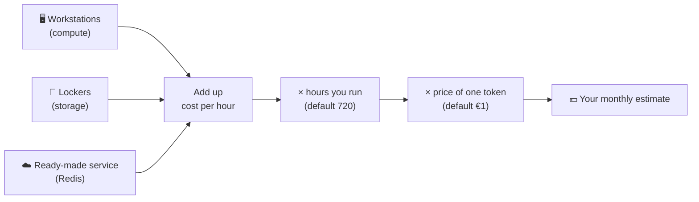
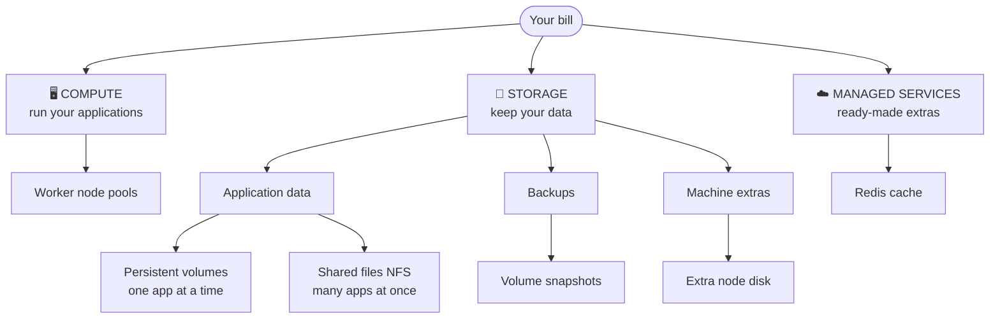
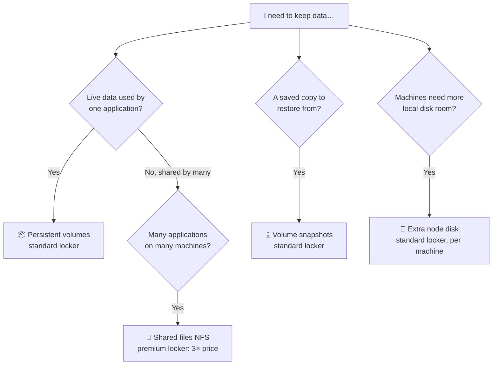
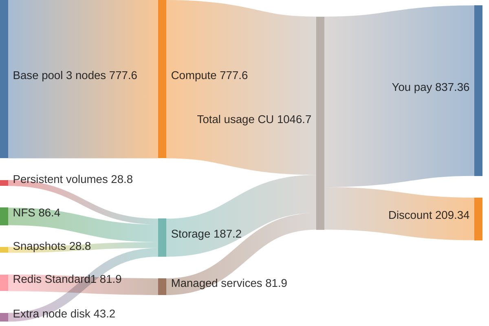

# Kyma pricing, explained simply

_How the Kyma Price Calculator turns "what I need" into "what I pay" — no cloud expertise required._

---

## 1. The idea in one minute

Think of Kyma like **renting a small workshop**:

- You rent **workstations** (computers) to do the work.
- You rent **storage lockers** to keep your stuff.
- Optionally, you hire a **ready-made service** (a managed Redis cache) instead of building it yourself.

Everything runs on a **meter**, like electricity: you pay **per hour** for whatever you have switched on. At the end of the month the meter total is multiplied by how many hours you ran, and converted into euros.



> **Estimated cost = (compute + storage + services per hour) × hours × price per token**

### The "arcade token" model

Every resource is priced in **tokens called Capacity Units (CU)**. A CU is not a CPU, a GB, or a euro — it's just a common currency so different things can be added together, like arcade tokens that work on every machine.

The last step converts tokens to euros. The **price per token** defaults to **€1.00**; lower it (e.g. €0.80) to reflect a discount. It's _your_ token price, **not** a currency exchange rate.

**Starting point:** the default cluster (3 small machines, nothing else) costs **777.60 CU = €777.60 a month**.

---

## 2. Three things you can rent

| What you rent           | Analogy                                             | In Kyma                         | You choose                | You pay for            |
| ----------------------- | --------------------------------------------------- | ------------------------------- | ------------------------- | ---------------------- |
| 🖥️ **Compute**          | Workstations in the workshop                        | Worker nodes (virtual machines) | Machine size and count    | Size × count × hours   |
| 💾 **Storage**          | Lockers, shelves and archives                       | Disks, shared drives, backups   | How many GiB of each kind | Lockers rented × hours |
| ☁️ **Managed services** | Hiring a ready-made kitchen instead of building one | Redis cache                     | A tier (size)             | Tier size × hours      |

And two **settings** that apply to everything: **running hours** and **price per token**.



---

## 3. Compute — the workstations

A **worker node** is one machine. A **pool** is a group of identical machines. You always have a **base pool** (3 machines by default); you can add more pools with different machine types.

Every machine size carries a **size tag in points**. Bigger machine → more points. Each point costs **0.12 CU per hour**.

```text
Cost of a pool = number of machines × size points × 0.12 × hours
```

**Analogy:** hiring cars. The size tag is the car class (compact = 3, van = 8, truck = 64). The hourly rate per class point is fixed; you pay for _every car, for every hour_ — whether or not it is busy.

|                       vCPUs | Points | Per hour (CU) | Per month (CU) |
| --------------------------: | -----: | ------------: | -------------: |
| 2 (default General Purpose) |      3 |          0.36 |         259.20 |
|                           4 |      4 |          0.48 |         345.60 |
|                           8 |      8 |          0.96 |         691.20 |
|                          16 |     16 |          1.92 |       1,382.40 |
|                          32 |     32 |          3.84 |       2,764.80 |
|                          48 |     48 |          5.76 |       4,147.20 |
|                          64 |     64 |          7.68 |       5,529.60 |

Per **machine**, per month (720 h). The three machine types:

| Type                  | Memory per vCPU | Good for                                         |
| --------------------- | --------------- | ------------------------------------------------ |
| **General Purpose**   | 4 GiB           | Most applications (the base pool is always this) |
| **Compute Optimized** | 2 GiB           | CPU-heavy work                                   |
| **Memory Intensive**  | 8 GiB           | Memory-heavy work                                |

Today all three types use the same points-per-vCPU, so the type changes _what you get_, not the rate. One quirk: the smallest General Purpose machine (2 vCPU) is tagged **3 points**, the small Compute Optimized and Memory Intensive ones **2 points**.

**Good to know**

- You pay for the **minimum** number of machines you set — the calculator does not guess about extra machines the autoscaler might add on busy days.
- Every machine **already includes a local disk** (80 GiB for small machines, up to 250 GiB for the largest). It's part of the machine price — **free**, no line on your bill.

---

## 4. Storage — the lockers

### The one rule: lockers come in 32 GiB sizes

Storage is rented in **lockers of 32 GiB**. You can't rent half a locker — a partial locker is rounded **up** to a whole one.

```text
  Need 10 GiB   →  [ 32 ]                 =  1 locker
  Need 32 GiB   →  [ 32 ]                 =  1 locker
  Need 33 GiB   →  [ 32 ][ 32 ]           =  2 lockers
  Need 100 GiB  →  [ 32 ][ 32 ][ 32 ][ 32 ]  =  4 lockers
```

A standard locker costs **0.02 CU per hour** (**14.40 CU per month**).

### Four kinds of storage



| Kind                      | Analogy                                     |   Price per locker | Free allowance        | How the count works                        |
| ------------------------- | ------------------------------------------- | -----------------: | --------------------- | ------------------------------------------ |
| 📦 **Persistent volumes** | A personal locker for one app               |          0.02 CU/h | **First locker free** | Round the **total** up to lockers, minus 1 |
| 🏢 **Shared files (NFS)** | A shared warehouse everyone can walk into   | **0.06 CU/h** (3×) | None                  | Round the **total** up to lockers          |
| 🗄️ **Volume snapshots**   | Photocopies in the archive                  |          0.02 CU/h | None                  | Round the **total** up to lockers          |
| 🧰 **Extra node disk**    | A bigger drawer built into each workstation |          0.02 CU/h | None                  | Round **per machine**, then × machines     |

> ⚠️ **Heads-up for persistent volumes:** the free locker is used by the cluster for its own housekeeping, so the field asks for **total capacity including that 32 GiB**. If your apps need 64 GiB, enter **96 GiB** (3 lockers − 1 free = 2 paid).

### Extra node disk: why it's different

You set it inside a worker pool (up to 128 GiB per machine), but it's **billed under Storage**. Since it is built into each machine, the rounding happens **per machine**:

```text
3 machines, each needs 10 GiB extra
  →  each machine rents 1 locker  →  3 lockers billed (96 GiB)
     even though you only asked for 30 GiB in total
```

Don't double count it: the summary shows it once under Storage.

### Per-locker price cheat-sheet

| Per month (720 h)                                              |    CU |
| -------------------------------------------------------------- | ----: |
| Standard locker (32 GiB) — volumes, snapshots, extra node disk | 14.40 |
| Shared-files locker (32 GiB) — NFS                             | 43.20 |

---

## 5. Managed services — Redis

Redis is a ready-made cache that Kyma runs for you. You don't pick a machine; you pick a **tier** (Standard 1–8 or Premium 1–6). Each tier has a fixed size and is priced **like storage, by size — without rounding up**:

```text
Redis cost = tier size ÷ 32 × 0.02 × hours
```

**Analogy:** buying a ready-made dish by weight instead of renting a kitchen — you pay for exactly the portion, not for whole lockers.

| Tier       | Size (GiB) | CU per month |
| ---------- | ---------: | -----------: |
| None       |          0 |            0 |
| Standard 1 |        182 |        81.90 |
| Standard 2 |        364 |       163.80 |
| Standard 3 |        953 |       428.85 |
| Standard 4 |      1,915 |       861.75 |
| Premium 1  |      1,903 |       856.35 |
| Premium 2  |      3,828 |     1,722.60 |

_(Larger Standard and Premium tiers continue the same way: size × 0.45 CU per GiB per month.)_

Standard vs Premium adds **no extra multiplier**; only the tier's size differs.

---

## 6. Time and money

| Setting                      | Default         | What it does                                                                                                |
| ---------------------------- | --------------- | ----------------------------------------------------------------------------------------------------------- |
| **Running hours**            | 720 (= 30 days) | Multiplies every charge. Use 24 for one day, 168 for one week, or fewer hours if you switch the cluster off |
| **Price per token (CU → €)** | €1.00           | Multiplies the final CU total. Use your discounted rate. Range €0.01–€1.20                                  |

Changing the hours changes **every** charge proportionally. Changing the token price changes the **euros only** — never the CU.

---

## 7. A complete example, step by step

**Meet Sam's team.** They run for a full month (720 h) at **€0.80 per token**:

- 3 default machines (2 vCPU, base pool)
- 10 GiB extra disk on every machine
- 96 GiB persistent volumes (64 GiB of their own + the 32 GiB housekeeping)
- 40 GiB shared files (NFS)
- 33 GiB of snapshots
- Redis Standard 1

| Step | What Sam adds         | Calculation                                 |     CU | Running total |
| ---- | --------------------- | ------------------------------------------- | -----: | ------------: |
| 1    | 🖥️ 3 machines         | 3 × 3 points × 0.12 × 720                   | 777.60 |        777.60 |
| 2    | 📦 Persistent volumes | 96 GiB = 3 lockers, 1 free → 2 × 0.02 × 720 |  28.80 |        806.40 |
| 3    | 🏢 Shared files       | 40 GiB = 2 lockers × 3 × 0.02 × 720         |  86.40 |        892.80 |
| 4    | 🗄️ Snapshots          | 33 GiB = 2 lockers × 0.02 × 720             |  28.80 |        921.60 |
| 5    | 🧰 Extra node disk    | 1 locker × 3 machines × 0.02 × 720          |  43.20 |        964.80 |
| 6    | ☁️ Redis Standard 1   | 182 ÷ 32 × 0.02 × 720                       |  81.90 |  **1,046.70** |
| 7    | 💶 Convert to euros   | 1,046.70 × €0.80                            |        |   **€837.36** |

### Where the tokens go

Read left to right: each charge → its category → total tokens → what you pay. Band width = CU.



<details>
<summary>Same diagram for <a href="https://sankeymatic.com/build/">SankeyMATIC</a> (paste into the Inputs box to export an image)</summary>

```text
// Charges -> categories
Base pool (3 nodes) [777.60] Compute
Persistent volumes [28.80] Storage
NFS [86.40] Storage
Snapshots [28.80] Storage
Extra node disk [43.20] Storage
Redis Standard1 [81.90] Managed services

// Categories -> total
Compute [777.60] Total usage (CU)
Storage [187.20] Total usage (CU)
Managed services [81.90] Total usage (CU)

// Total -> what you pay
Total usage (CU) [837.36] You pay (at 0.80 per CU)
Total usage (CU) [209.34] Discount vs 1.00 per CU

// Optional colours
:Compute #4c78a8
:Base pool (3 nodes) #4c78a8
:Storage #f58518
:Persistent volumes #f58518
:NFS #f58518
:Snapshots #f58518
:Extra node disk #f58518
:Managed services #54a24b
:Redis Standard1 #54a24b
```

</details>

**What the picture tells you**

- **Compute is the bulk** (about three-quarters) of this bill — machines are usually the biggest lever.
- **NFS is the biggest storage band** even though it's only 40 GiB, because its lockers cost 3×.
- The token price **only splits** the same total into "you pay" and "discount" — it never changes the token count.

---

## 8. What moves your bill

| If you…                                            | The bill…                                                         |
| -------------------------------------------------- | ----------------------------------------------------------------- |
| Add a machine or a pool                            | Goes up by that machine's size points × 0.12 × hours              |
| Choose a bigger machine size                       | Goes up with its points (the local disk included grows too, free) |
| Add 1 GiB of storage inside a locker that has room | **Doesn't change**                                                |
| Cross a 32 GiB boundary (32 → 33 GiB)              | Goes up by **one whole locker**                                   |
| Put data in NFS instead of persistent volumes      | Costs **3×** per locker (but no free locker)                      |
| Add Redis                                          | Goes up in proportion to the tier size                            |
| Run fewer hours                                    | Drops proportionally — every item                                 |
| Lower the price per token                          | Drops in euros only                                               |

Three quick ways to cut cost: **right-size machines**, **run fewer hours** for non-production clusters, and **keep sizes just below a 32 GiB boundary**.

---

## 9. Good to know

This is an **estimate**, not an invoice. SAP's official billing is the final word.

- **Constant configuration.** The estimate assumes everything runs unchanged for the hours you enter, using the **minimum** machine count. Scaling up and down during the month isn't modelled.
- **What isn't priced.** The calculator has no separate lines for network traffic, taxes or other cloud services. That doesn't mean they are free in reality.
- **You size things yourself.** Modules and applications aren't priced individually — you account for them by choosing machine sizes and storage amounts.
- **Totals are rounded once per kind.** For persistent volumes, NFS and snapshots, the calculator rounds the **total** you enter once, not each volume separately.
- **Some rules are still being validated** against SAP's documentation (for example, how extra node disk, snapshots and Redis are rounded or priced). These are tracked in the [pricing discrepancy tracker](./pricing-discrepancies.md).
